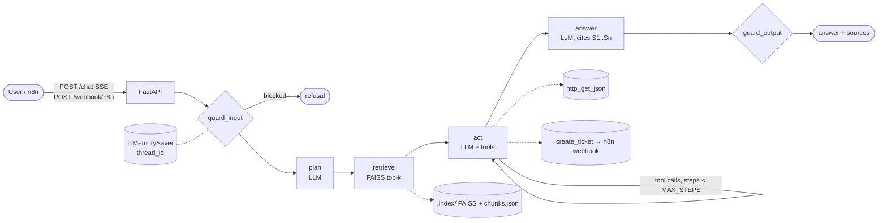

# agent-starter

[](https://github.com/climaa/agent-starter/actions/workflows/ci.yml)

[](LICENSE)

A reusable Python starter for tool-using RAG agents — **guardrails → plan → retrieve → act → answer** in LangGraph, served over FastAPI (SSE + n8n webhook), with evals, Docker and CI — so you can start from a tested skeleton instead of a blank file.

It runs **fully offline** (deterministic fake LLM + local hashing embeddings) and switches to AWS Bedrock, Anthropic or OpenAI through `.env`.

## Quickstart (60 seconds, no cloud keys)

Needs [uv](https://docs.astral.sh/uv/) and Python 3.12.

```bash
git clone https://github.com/climaa/agent-starter && cd agent-starter
make setup                 # uv sync + .env from .env.example
make demo OFFLINE=1        # RAG answer with citation, tool call, blocked prompt injection
```

With Docker, `make smoke` brings up the API + n8n with `docker-compose.offline.yml`, runs three end-to-end checks and tears everything down. Expected output (trimmed):

```text
[smoke] starting api + n8n (n8n 2.47.4, offline providers)
[smoke] ready: api /health agent_ready
[smoke] ready: n8n /healthz/readiness
[smoke] importing + publishing n8n workflow
[smoke] ready: n8n webhooks registered
[smoke] 1/3 RAG answer via n8n /webhook/ask
[smoke] HTTP 200 {"thread_id":"smoke","answer":"Customers can request a refund within 30 days of delivery. [S1]","sources":[...],"guardrail_notes":[]}
[smoke] 2/3 tool call: agent create_ticket -> n8n /webhook/ticket
[smoke] HTTP 200 {"thread_id":"...","answer":"If a parcel arrives damaged, ... [S1] Action taken: create_ticket -> {\"status\": \"created\", ... \"ticket_id\":\"N8N-1794410541254\...
[smoke] 3/3 api /webhook/n8n rejects a missing token (so 1/3 proves n8n sent it)
[smoke] HTTP 401 as expected
[smoke] PASS
```

Other targets:

```bash
make lint test             # ruff + mypy --strict + pytest (offline)
make eval OFFLINE=1        # hit-rate / faithfulness table
make dev                   # API on :8000 (uses .env → Bedrock by default)
```

## Architecture



| File | What it is |
|---|---|
| `src/agent_starter/graph/build.py` | The whole graph wiring, ~50 lines. Start here. |
| `graph/nodes.py` | One async method per node. Each returns a partial state update. |
| `graph/state.py` | Pydantic `AgentState`. `messages` persist per `thread_id`; the other fields reset every turn. |
| `graph/guardrails.py` | Pure-function input checks (injection, length, secrets) and output checks (citations, secret leak). |
| `prompts.py` | **Every prompt in one file.** |
| `providers.py` | `get_chat_model()` / `get_embeddings()` from env, plus the offline fakes. |
| `rag/ingest.py`, `rag/store.py` | `./data` (md/txt/pdf) → recursive chunks → FAISS. About 60 lines, no pickle. |
| `tools/` | Registry. **One file = one tool** (auto-discovered). |
| `api/main.py` | `/chat` (SSE: `node`, `token`, `final`), `/webhook/n8n`, `/health`, request-id middleware. |
| `observability.py` | JSON logs with `request_id`/`thread_id`. Langfuse callback turns on only when keys are set. |
| `evals/run.py` + `eval/evalset.yaml` | hit@k, lexical faithfulness, keyword correctness. |

## Providers

Pick providers with environment variables (see `.env.example`; never commit `.env`).

| Role | `LLM_PROVIDER` / `EMBEDDINGS_PROVIDER` | Credentials / settings |
|---|---|---|
| **Default** | `bedrock` — Claude via `ChatBedrockConverse`; Titan v2 embeddings | `AWS_REGION`, plus the standard AWS chain (`AWS_PROFILE`, SSO or instance role) |
| Fallback | `anthropic` (LLM only) | `ANTHROPIC_API_KEY` |
| Fallback | `openai` (LLM and embeddings) | `OPENAI_API_KEY` |
| Offline / tests | `fake` (LLM), `local` (embeddings) | none — deterministic, no network |

`LLM_MODEL` and `EMBEDDINGS_MODEL` override the per-provider defaults in `providers.py`. The fake LLM copies the best-matching sentence and cites it; tests and CI use only the offline pair. After switching embeddings providers, re-run `make ingest`.

## Adapting it to your domain

1. **Data.** Replace `data/*` with your documents and run `make ingest OFFLINE=1` to check chunking.
2. **Prompts.** Edit `prompts.py`: set `DOMAIN`, plus the tone and refusal rules in `ANSWER_SYSTEM`.
3. **Tools.** Copy `tools/ticket.py` to `tools/<action>.py`; change the args model, function body and description. Delete example tools you don't need.
4. **Guardrails.** Add domain rules to `guardrails.py` (denied topics, PII regexes, length).
5. **Eval.** Rewrite the cases in `eval/evalset.yaml` and run `make eval OFFLINE=1`.
6. **Real model.** Set `LLM_PROVIDER` and credentials in `.env` (see [Providers](#providers)), then `make demo` and `make dev`.
7. Only if needed: change the graph shape in `build.py`, e.g. a human-approval node before risky tools or a router node.

Keep `make test` green as you go; the e2e tests in `tests/test_graph_e2e.py` mirror the demo flows.

## API

```bash
curl -N localhost:8000/chat -H 'content-type: application/json' \
  -d '{"message":"How many days to request a refund?","thread_id":"demo"}'
# event: node   data: {"node":"guard_input"} ... event: token ... event: final {answer, sources, guardrail_notes}

curl localhost:8000/webhook/n8n -H 'content-type: application/json' -d '{"message":"open a ticket, parcel damaged"}'
```

**n8n.** Run `docker compose up --build` (add `-f docker-compose.yml -f docker-compose.offline.yml` to use the fake LLM and local embeddings without credentials). Then import and publish the workflow; n8n only registers webhooks for published workflows:

```bash
docker compose exec n8n n8n import:workflow --input=/workflows/agent-workflow.json
docker compose exec n8n n8n publish:workflow --id=agentStarterAsk1   # n8n >= 2.x
```

It sets up two flows:
- `POST :5678/webhook/ask` → calls the agent's `/webhook/n8n` → returns the answer.
- `POST :5678/webhook/ticket` receives the agent's `create_ticket` tool calls and returns a ticket id. Replace this with Jira, Slack or email nodes.

If `N8N_WEBHOOK_TOKEN` is set (shell or `.env`), compose passes the same value to both containers: n8n sends it as `X-Webhook-Token` and the API requires it.

**Smoke test details.** `scripts/smoke.sh` pins n8n to `N8N_VERSION=2.47.4` by default, uses host ports 8000 and 5678, removes volumes on exit, and leaves the stack running with `KEEP_UP=1`. CI runs it as the `smoke` job.

## Design trade-offs

- Lexical faithfulness metric instead of an LLM-as-judge: deterministic, free and offline, but blind to paraphrase. Production would add an LLM judge (or RAGAS) on a larger golden set.
- In-process FAISS and `InMemorySaver`: no infrastructure, but single-instance, and memory is lost on restart.
- A separate `plan` LLM call adds latency. For simple use cases, merge it into `act`.
- Regex guardrails are cheap but easy to bypass. They are a first layer, not the whole defence.

## Taking it to production (AWS)

- **Compute.** Run the API on ECS Fargate (SSE and long requests) behind an ALB. Use Lambda for the n8n or async event paths. Build ingest as a separate Step Functions or Lambda job triggered by S3 uploads.
- **Models.** Bedrock with cross-region inference profiles, Bedrock Guardrails (PII, denied topics, contextual grounding check) on input and output, and model fallback in the provider factory.
- **Data.** OpenSearch Serverless, pgvector on Aurora, or Bedrock Knowledge Bases instead of FAISS. A DynamoDB or Postgres LangGraph checkpointer instead of the in-memory one.
- **Secrets & IAM.** Secrets Manager for webhook tokens and API keys. A task role with least-privilege `bedrock:InvokeModel` on specific model ARNs. No keys in env files.
- **Observability.** OpenTelemetry (ADOT collector) to X-Ray and CloudWatch, Langfuse for LLM traces and cost. Alarms on p95 latency, guardrail block rate and tool error rate.
- **Evaluation.** Golden set in CI as a regression gate, online sampling with an LLM judge, and human feedback captured per `thread_id`.
- **Safety.** A human-in-the-loop interrupt (`langgraph` `interrupt()`) before irreversible tools, idempotency keys on ticket creation, and rate limiting per tenant.

## Development

- Python 3.12, uv, `src/` layout. `make lint` runs ruff and `mypy --strict` on `src`. `make test` runs pytest with pytest-asyncio and respx (HTTP mocked).
- Never commit secrets: only `.env.example` is tracked. CI's `secrets` job runs gitleaks over the full git history (config in `.gitleaks.toml`).
- Sample data in `data/` is a fictional company ("Northwind Logistics"). The corpus is tiny, so hit@k is an easy bar here. Re-baseline it on your own data.

## License

MIT. See [LICENSE](LICENSE). The sample data in `data/` and the n8n workflow in `n8n/` were written for this repo and are covered by the same license.
